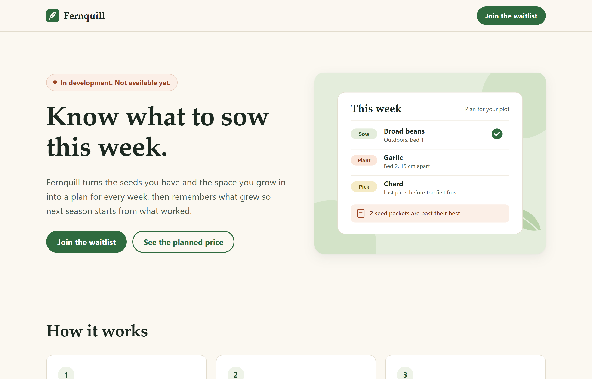
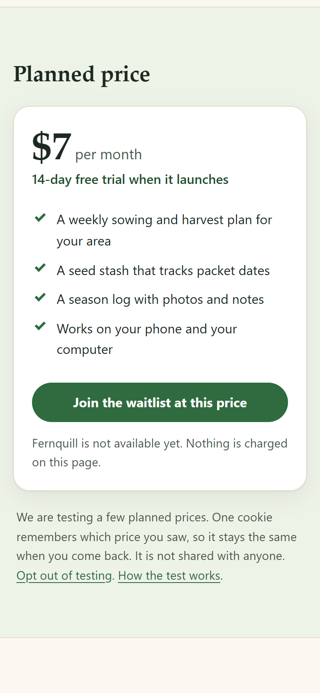
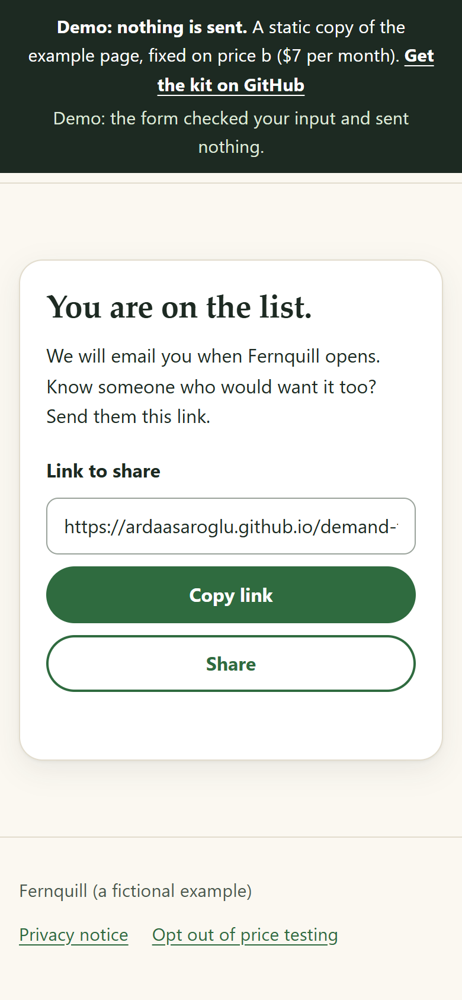
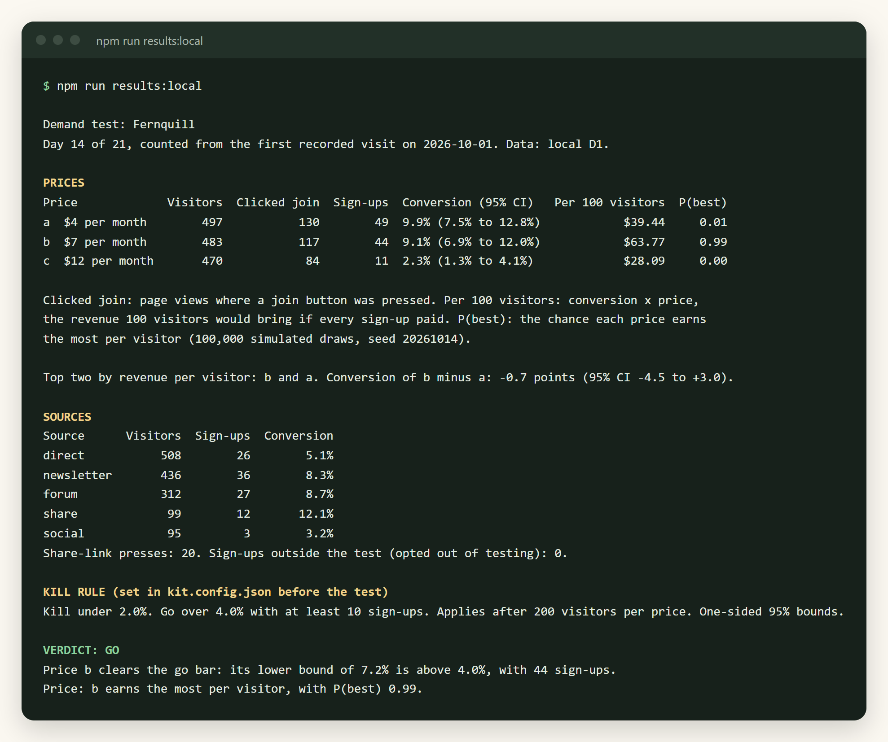

<h1 align="center">demand-test-kit</h1>

<p align="center"><strong>Test demand and price before you build.</strong></p>

<p align="center">A landing page with a price A/B test, a waitlist, source tags and a kill rule you set in advance. Free on Cloudflare.</p>

<p align="center">
<a href="https://ardaasaroglu.github.io/demand-test-kit/"><strong>Live demo</strong></a> ·
<a href="#quickstart">Quickstart</a> ·
<a href="#deploy">Deploy</a> ·
<a href="#read-the-results">Read the results</a> ·
<a href="#the-kill-rule">The kill rule</a> ·
<a href="#privacy-and-legal-notes">Privacy</a> ·
<a href="docs/playbook.md">Playbook</a>
</p>

<p align="center"><a href="https://github.com/ardaasaroglu/demand-test-kit/actions/workflows/ci.yml"></a></p>



You describe a product that does not exist yet. Each visitor sees one of two to four planned prices and can join a waitlist. Links you share carry a tag, so you know which channel worked. Before you share anything, you write down the numbers that mean "build it" and "drop it". `npm run results` then tells you which one you got.

> **Status: 0.1.0.** Everything that runs locally was run for this release and is covered by tests that run the Worker in the local Workers runtime. Deploying to Cloudflare, by command line or by button, follows Cloudflare's documentation but was not run against a real Cloudflare account for this release. The example product, Fernquill, is fictional.

## What you get

* **A landing page** for your idea, written from one config file. It says the product is not available yet before it asks for an email address, and it never asks for payment.
* **A price test.** Each new visitor gets one of your planned prices at random, split evenly. A cookie keeps the price the same on the next visit, or you choose a mode with no cookie at all.
* **A waitlist** with an email field, an optional name, one optional single-choice question and an unticked consent box. A repeat sign-up is ignored without saying so, a hidden field catches simple bots, and a speed bump slows down scripts.
* **Source tags.** Share `/?src=newsletter` in your newsletter and `/?src=forum` on a forum, and the report splits visitors and sign-ups by tag. People who join get a share link tagged `share`.
* **A report** from `npm run results`: visitors, clicks and sign-ups per price, conversion with a 95% Wilson interval, revenue per 100 visitors, the probability that each price earns the most per visitor, and a verdict from your kill rule.
* **A privacy notice** at `/privacy`, filled in from your config, with the cookie table for the mode you chose. Rows are deleted automatically after the number of days you set.
* **Nothing from other companies.** No analytics vendor, no fonts or scripts from a CDN, a strict Content Security Policy, no IP addresses stored.
* **The free Cloudflare plan is enough:** a Worker, static files and a D1 database.

<p align="center">

&nbsp;

</p>



## Quickstart

You need Node 22 or newer. Running it locally needs no Cloudflare account.

```bash
git clone https://github.com/ardaasaroglu/demand-test-kit.git && cd demand-test-kit
npm install
npm run dev
```

Open <http://localhost:8787>. `npm run dev` checks `kit.config.json`, creates the local database tables and starts the Worker on your machine. Local data lives in `.wrangler/`, which git ignores.

On Windows, clone into a short path such as `C:\dev\demand-test-kit`. The local database file sits 120 characters below the project folder, so in a deep folder its path passes the 260-character limit and `npm run dev` stops with "internal error".

Want to see the report before you have visitors? In a second terminal:

```bash
npm run seed:local     # replaces the local database with 14 days of simulated traffic
npm run results:local
```

The [live demo](https://ardaasaroglu.github.io/demand-test-kit/) is a static copy of the same page. Its form checks your input and sends nothing.

## Deploy

The kit runs as one Cloudflare Worker with static files and a D1 database. Deploy it on your own Cloudflare account. Nothing in this repository points at anyone else's.

### From the command line

```bash
npm install
npx wrangler login
npm run deploy
```

`npm run deploy` checks the config, runs `wrangler deploy`, then `wrangler d1 migrations apply DB --remote` to create the tables. The order matters: without a `database_id`, the database only exists after the first `wrangler deploy`, so its tables are created after it.

About the database id: `wrangler.jsonc` has no `database_id` on purpose. Cloudflare documents that `wrangler deploy` then creates the database for you and writes its id back into `wrangler.jsonc` ([automatic provisioning](https://developers.cloudflare.com/workers/wrangler/configuration/#automatic-provisioning)). Commit that change, so later deploys use the same database. If you prefer to create it yourself, run `npx wrangler d1 create demand-test-kit` and add the id it prints as `"database_id"` in `wrangler.jsonc`.

Good to know:

* A new Cloudflare account has no `workers.dev` subdomain yet. Wrangler asks to register one on the first deploy. In a shell that cannot answer questions it stops instead, so register it in the dashboard under Workers first.
* The page is then at `https://demand-test-kit.<your-subdomain>.workers.dev`. To use another name, change `"name"` in `wrangler.jsonc` before the first deploy.
* On the very first deploy there are a few seconds between the Worker going live and the tables existing. A visit in that window is shown the page but not counted. A sign-up in that window gets an error. Share the link after `npm run deploy` has finished.

### With the button

[](https://deploy.workers.cloudflare.com/?url=https://github.com/ardaasaroglu/demand-test-kit)

Cloudflare's deploy flow copies this repository into your GitHub or GitLab account, creates the D1 database in your Cloudflare account, and builds with the `deploy` script from `package.json`, which applies the migration after deploying ([deploy buttons](https://developers.cloudflare.com/workers/platform/deploy-buttons/)).

Cloudflare's documentation disagrees on the database id in this flow. The deploy buttons page says Cloudflare updates the Wrangler configuration with the new ids. The [configuration page](https://developers.cloudflare.com/workers/wrangler/configuration/#automatic-provisioning) says ids are not written back to your repository when you deploy from the dashboard. After the first build, open `wrangler.jsonc` in your copy. If it has no `"database_id"`, copy the id from the dashboard (Storage & Databases, D1) into it, so every later build uses the same database.

The button was not clicked end to end for this release. If it fails, use the command line above, and please open an issue.

## Customize

Everything a maker edits is in `kit.config.json`. Run `npm run check` after editing: it lists every problem at once, with the field and what it expected. `npm run dev` and `npm run deploy` run it first, and the Worker itself refuses to start on an invalid config, so a typo cannot reach visitors.

| Field | What it does |
| --- | --- |
| `product.name`, `product.tagline`, `product.description` | The name, the headline and the paragraph under it. They are also the page title and the link preview text. |
| `product.heroImage` | `{ "file": "hero.svg", "alt": "..." }`: an image in `public/assets/` and its description, or `null` for none. |
| `product.steps`, `product.features`, `product.faq` | "How it works" (up to 4 steps), the list in the price card (up to 8), and questions with answers (up to 10). An empty list hides the section. |
| `test.startDate` | The day you start sharing the link, such as `"2026-11-02"`. `null` counts from the first recorded visit. |
| `test.maxDays` | How long the test runs. The price cookie lasts as long. |
| `pricing.variants` | 2 to 4 prices, such as `{ "id": "a", "price": 9 }`, with an optional `"label"` shown above the price. |
| `pricing.currency`, `pricing.locale` | A currency code such as `"EUR"` and a locale such as `"de-DE"`. The locale sets how prices are written. The page text stays English, see [Limitations](#limitations). |
| `pricing.billingPeriod`, `pricing.trialDays` | `"month"`, `"year"`, `"week"` or `"once"`, and the free trial you plan to offer (`0` hides the line). |
| `killRule` | The decision rule. See [The kill rule](#the-kill-rule). |
| `privacy.controllerName`, `privacy.contactEmail`, `privacy.jurisdictionNote`, `privacy.lastUpdated` | Who runs the page and how to reach them, shown on the privacy notice. `npm run check` warns while the address is still `you@example.com`. |
| `privacy.retentionDays` | Views, clicks and sign-ups older than this are deleted once a day. At least `test.maxDays`. |
| `privacy.stickiness` | `"cookie"` (default), `"consent"` or `"none"`. See [Cookie modes](#cookie-modes). |
| `form.askName` | Show an optional name field. |
| `form.question` | One optional single-choice question, `{ "label": "...", "required": false, "options": [{ "id": "...", "label": "..." }] }`, or `null`. |
| `form.consentText`, `form.consentVersion` | The sentence next to the unticked box, and a label stored with each sign-up. Change the version whenever you change the sentence. |

Images: replace the files in `public/assets/` (`hero.svg`, `og.png` at 1200 x 630 for link previews, `favicon.svg`, `apple-touch-icon.png` at 180 x 180) and `public/favicon.ico`. Wording that is the same for every product, such as "Join the waitlist", is not in the config. [Limitations](#limitations) lists the four places that hold it.

## Share

Tag every link you post with `?src=`:

```text
https://demand-test-kit.<your-subdomain>.workers.dev/?src=newsletter
https://demand-test-kit.<your-subdomain>.workers.dev/?src=forum
https://demand-test-kit.<your-subdomain>.workers.dev/?src=friends
```

* A tag is up to 32 letters, digits, dots, dashes or underscores. It is stored in lowercase.
* `?utm_source=` works too, when `src` is missing.
* No tag counts as `direct`. Anything that is not a plain tag counts as `other`.
* After joining, people get a share link tagged `share`, so you can see what word of mouth brings.

Use one tag per place, so the source table answers "where should I post next".

## Read the results

```bash
npm run results          # the deployed database (after npx wrangler login)
npm run results:local    # the local database that npm run dev uses
```

Sample output, from `npm run seed:local` (simulated data):

```text
Demand test: Fernquill
Day 14 of 21, counted from the first recorded visit on 2026-10-01. Data: local D1.

PRICES
Price             Visitors  Clicked join  Sign-ups  Conversion (95% CI)   Per 100 visitors  P(best)
a  $4 per month        497           130        49  9.9% (7.5% to 12.8%)            $39.44     0.01
b  $7 per month        483           117        44  9.1% (6.9% to 12.0%)            $63.77     0.99
c  $12 per month       470            84        11  2.3% (1.3% to 4.1%)             $28.09     0.00

Clicked join: page views where a join button was pressed. Per 100 visitors: conversion x price,
the revenue 100 visitors would bring if every sign-up paid. P(best): the chance each price earns
the most per visitor (100,000 simulated draws, seed 20261014).

Top two by revenue per visitor: b and a. Conversion of b minus a: -0.7 points (95% CI -4.5 to +3.0).

SOURCES
Source      Visitors  Sign-ups  Conversion
direct           508        26        5.1%
newsletter       436        36        8.3%
forum            312        27        8.7%
share             99        12       12.1%
social            95         3        3.2%
Share-link presses: 20. Sign-ups outside the test (opted out of testing): 0.

KILL RULE (set in kit.config.json before the test)
Kill under 2.0%. Go over 4.0% with at least 10 sign-ups. Applies after 200 visitors per price. One-sided 95% bounds.

VERDICT: GO
Price b clears the go bar: its lower bound of 7.2% is above 4.0%, with 44 sign-ups.
Price: b earns the most per visitor, with P(best) 0.99.
```

How to read it:

* **Visitors** counts people the first time they get a price. A returning visitor with the price cookie is counted again only as a view. Without the cookie (consent declined, `none` mode, cleared cookies, another device), each visit counts as a new visitor.
* **Conversion** is sign-ups divided by visitors, with a 95% Wilson interval, which stays sensible with few sign-ups.
* **Per 100 visitors** is conversion times price: what each price would earn if every sign-up paid. A cheaper price often wins on conversion and loses here.
* **P(best)** is the chance each price earns the most per visitor, from Beta posteriors with a uniform prior and 100,000 seeded draws, so the same data always prints the same numbers.
* **Top two** compares the conversion of the two best earners with Newcombe's interval for a difference. An interval that crosses zero means the data cannot tell their conversion apart.
* `npm run results -- --as-of 2026-11-02` evaluates the rule as of another day.

The report reads only aggregate counts: three grouped queries, one per table. In local measurements each run read every stored row twice (5,000 views cost 10,000 row reads).

Export the waitlist to `exports/signups-<date>.csv` with `npm run export` (or `npm run export:local`). Cells that a spreadsheet would run as a formula, those starting with `=`, `+`, `-`, `@`, a tab or a carriage return, are prefixed with an apostrophe. To delete one person on request: `npm run forget -- person@example.com`.

## The kill rule

Decide what "build it" and "drop it" mean before you share the link, and commit it. That commit is your proof that you did not move the bar after seeing the numbers.

```json
"killRule": {
  "minVisitorsPerVariant": 200,
  "killFloorRate": 0.02,
  "goBarRate": 0.04,
  "goMinSignups": 10,
  "confidence": 0.95
}
```

Each time you run `npm run results`, the rule gives one verdict:

| Verdict | When |
| --- | --- |
| NOT ENOUGH DATA | A price has fewer than `minVisitorsPerVariant` visitors. The report says how many are missing. |
| KILL | Even the best price's upper bound is below `killFloorRate`. With the rule above, 0 sign-ups from 200 visitors has an upper bound of 1.33%, so the 2% floor kills it. |
| GO | A price's lower bound is above `goBarRate` and it has at least `goMinSignups` sign-ups. If several pass, the one that earns most per visitor is named. |
| KEEP RUNNING | The best price is between the two bars. |
| TIME UP | `test.maxDays` have passed without a KILL or GO. Do what you decided in advance: iterate or drop. |

Bounds are one-sided Wilson bounds at `confidence`. The price line under the verdict names a winner only when its P(best) reaches `confidence`.

**Plan the sample.** Visitors needed per price to tell two conversion rates apart, at 5% significance and 80% power (computed by `sampleSizePerArm` in `src/stats.js`, checked in the tests):

| From | To | Visitors per price |
| --- | --- | --- |
| 5% | 10% | 435 |
| 3% | 6% | 749 |
| 2% | 4% | 1,141 |
| 5% | 7.5% | 1,471 |

A small test can only find large differences, roughly a doubling. Test prices that are far apart, and test two or three, not four.

**Do not stop at the first good day.** Checking a significance test repeatedly and stopping at the first win pushed false positives to 26.1% in [Evan Miller's simulation](https://www.evanmiller.org/how-not-to-run-an-ab-test.html). This rule only acts after the minimum sample, but every extra look still adds risk. Look once a day at most, run at least a full week, and raise `confidence` to 0.99 if you will look more often. [docs/playbook.md](docs/playbook.md) walks through a whole test.

## Privacy and legal notes

This section is a summary of public guidance, not legal advice. Check it against your own situation and jurisdiction.

What the kit does by default:

* It stores, per page view: the price shown, the link tag, the time and a random page-view number. No IP address, no browser details, no identifier that follows a person between visits. Request logging in Cloudflare (`invocation_logs`) is switched off in `wrangler.jsonc`.
* It stores a sign-up only with the unticked consent box ticked, together with the `consentVersion` and the time.
* It deletes views, clicks and sign-ups older than `privacy.retentionDays`, once a day.
* It loads nothing from other companies.
* It says the product is not available before the email field, and never asks for payment.

### Cookie modes

| `privacy.stickiness` | What is stored on the device | A returning visitor |
| --- | --- | --- |
| `"cookie"` (default) | `dtk_variant`, the price letter only, for `test.maxDays` days. A notice next to the price explains it, with a one-click "Opt out of testing" link that sets `dtk_optout` and stops counting. | Sees the same price and counts once. |
| `"consent"` | Nothing until the visitor presses Allow in a small banner. Then `dtk_variant`. A footer link removes it again. | After Allow: the same price. After No thanks: a new price per visit, counted per visit. |
| `"none"` | Nothing at all. | May see another price, counted per visit. Keep the test short. |

### EU and UK, in short

* **EU, cookies.** Storing or reading anything on a visitor's device needs consent unless it is strictly necessary for a service the visitor asked for (ePrivacy Directive Art. 5(3), as amended by 2009/136/EC). This covers any stored information, not only cookies ([EDPB Guidelines 2/2023](https://www.edpb.europa.eu/documents/guideline/guidelines-22023-on-technical-scope-of-art-53-of-eprivacy-directive_en)). Article 29 Working Party Opinion 04/2012 found first-party analytics cookies not exempt ([WP194](https://ec.europa.eu/justice/article-29/documentation/opinion-recommendation/files/2012/wp194_en.pdf)). France's CNIL exempts some audience measurement, but whether a price test counts is untested, and the EU "Digital Omnibus" proposal for an aggregated-measurement exemption was not law as of October 2026. For visitors in the EU, `"consent"` is the cautious choice.
* **UK, cookies.** The Data (Use and Access) Act 2025 added a "statistical purposes" exception to PECR regulation 6. The ICO's final guidance of 29 April 2026 names A/B testing as likely to qualify when the sole purpose is improving the service, people get clear information, and there is a simple and free way to object ([ICO](https://ico.org.uk/for-organisations/direct-marketing-and-privacy-and-electronic-communications/guidance-on-the-use-of-storage-and-access-technologies/what-are-the-exceptions/)). The `"cookie"` mode's notice and opt-out link are built for that.
* **Email addresses.** Consent has to be specific and unambiguous, and a pre-ticked box is not consent (CJEU, Planet49, [C-673/17](https://curia.europa.eu/juris/liste.jsf?num=C-673/17)). You must be able to show consent (GDPR Art. 7(1)), which is why each sign-up stores `consentVersion` and the time, and withdrawing must be as easy as giving it (Art. 7(3)): the privacy notice gives your address, and `npm run forget` deletes a person. Double opt-in is not in the GDPR text but is the usual evidence. The kit sends no email, so make your first email a confirmation.
* **Different prices.** The EU Omnibus Directive 2019/2161 requires telling consumers when a price is personalised by automated decision-making. Random assignment is arguably not personalisation, and the page says prices are being tested anyway. Ask counsel if you sell into the EU.

Before you share the page: fill in the four `privacy` fields, read your `/privacy` page once, choose the cookie mode for your audience, and set a retention period you will keep.

## Free tier limits

| Resource | Free limit | Source |
| --- | --- | --- |
| Worker requests | 100,000 per day, reset at 00:00 UTC | [Workers limits](https://developers.cloudflare.com/workers/platform/limits/) |
| Static file requests | Free and unlimited | [Workers pricing](https://developers.cloudflare.com/workers/platform/pricing/) |
| CPU time | 10 ms per request | [Workers limits](https://developers.cloudflare.com/workers/platform/limits/) |
| D1 rows read | 5 million per day | [D1 pricing](https://developers.cloudflare.com/d1/platform/pricing/) |
| D1 rows written | 100,000 per day | [D1 pricing](https://developers.cloudflare.com/d1/platform/pricing/) |
| D1 storage | 500 MB per database, 5 GB per account | [D1 limits](https://developers.cloudflare.com/d1/platform/limits/) |
| Cron Triggers | 5 per account | [Workers limits](https://developers.cloudflare.com/workers/platform/limits/) |

What the kit uses:

* Requests for static files (CSS, JavaScript, images) do not run the Worker and do not count. Everything else does: `/`, `/privacy` and `/api/*` (`run_worker_first` in `wrangler.jsonc`), and any path that matches no file, because the Worker answers the 404. Scanners that probe random paths count too.
* A page view is one Worker request and one written row. A button press or a sign-up is one request, one read and one written row. The tests check the one-row writes.
* The daily clean-up uses one of your account's Cron Triggers.
* So the free plan carries roughly 100,000 page views a day. Past the request limit, the page answers with an error until the limit resets. On D1's daily limits, queries fail until they reset.

The Worker does little per request, but its CPU time was not measured on Cloudflare for this release.

## FAQ

**Is it fair to show visitors different prices?**
The page says prices are being tested, nobody can pay, and every visitor is told the product is not available yet. The price someone sees is a planned price. If you launch, decide in advance what you will offer the people who signed up.

**Why no analytics tool?**
The kit counts the few things the decision needs, on your own database. A third-party tool adds a request to someone else, more consent questions and more data than the test needs.

**How do I email the waitlist?**
Export it with `npm run export` and import the CSV into your email tool. The kit sends no email.

**Can I change the prices during a test?**
Better not: it splits your data into two smaller tests. If you must, give the new prices new ids. The report leaves out ids that are no longer in the config and says so. Their sign-ups stay in the export.

**Does the form work without JavaScript?**
No. The page shows, the form's "Join the waitlist" button stays disabled, and a note says the form needs JavaScript. The form posts to `/api/signup`, so even a form sent some other way never puts the address in a URL. The cookie banner in `"consent"` mode works without JavaScript and keeps the visitor on the same price.

## Limitations

* **Sign-ups measure stated intent, not purchases.** People join waitlists more easily than they pay. Treat the go bar as a screen, and follow a GO with a real pre-sale or a paid pilot.
* **Small tests only find big differences.** See the sample table above.
* **Visitors are approximate.** People who clear cookies or use two devices count twice. In `"none"` mode, and for visitors who decline in `"consent"` mode, every visit counts as a new visitor.
* **The bot filter reads the user agent.** It drops crawlers, link previews (including the Mastodon, Bluesky and other fediverse preview fetchers), monitors and scripts that say what they are. A bot that pretends to be a browser is counted. People who open your link inside the LinkedIn, Pinterest, Telegram, Facebook or Instagram app are counted as visitors, and the tests check those user agents.
* **The speed bump is per Worker instance.** It allows 5 sign-ups per IP address per 10 minutes on one instance, and Cloudflare runs many. For real abuse, add [Cloudflare Turnstile](https://developers.cloudflare.com/turnstile/) or a rate limiting rule in your Cloudflare dashboard.
* **No email confirmation.** Anyone can type someone else's address. The kit never emails it, but your first email should ask people to confirm.
* **Even split only.** There are no traffic weights per price.
* **English wording.** The text visitors see is in four places: `src/templates/` (the page, its buttons and the privacy notice, each with `lang="en"`), `src/render.js` (the price-test notice, cookie banner, cookie table, section headings, trial line and billing period words), `src/app.js` (messages from the server) and `public/assets/app.js` (form messages in the browser). To translate the page, edit all four.
* **Not run on a real Cloudflare account for this release**: the remote deploy, the button, the scheduled clean-up in production and the remote results and export commands. The same code paths run locally and in the tests.

## Project layout

```text
kit.config.json        everything a maker edits
wrangler.jsonc         Worker, static files, D1 binding, daily clean-up
migrations/            D1 tables (0001_init.sql)
src/index.js           Worker entry: loads and validates the config
src/app.js             routes: page, privacy notice, events, sign-up, consent, opt-out, clean-up
src/config.js          config validation with readable errors
src/render.js          fills the HTML templates, escaping every config value
src/templates/         landing page and privacy notice HTML
src/validate.js        email, link tag, bot and cookie helpers
src/csv.js             CSV export with the formula guard
src/stats.js           Wilson, Newcombe, Beta-Binomial, sample size
src/killrule.js        the verdict
src/report.js          the results report and its queries
public/                static files, with their headers in public/_headers
scripts/               check, results, export, forget, seed, demo build
test/                  node:test suites: unit tests, and Worker tests in the local runtime via wrangler's test harness
docs/                  the static demo (GitHub Pages), screenshots and the playbook
```

## Contributing

Small, focused changes are welcome. Read [CONTRIBUTING.md](CONTRIBUTING.md) first. For a security problem, follow [SECURITY.md](SECURITY.md) instead of opening an issue.

## License

[MIT](LICENSE)
